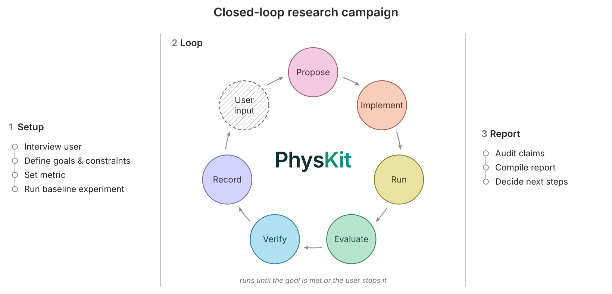

<!--
DRAFT: full rewrite of the public README. Before release:
  - add the physkit.org badge and link once the site is live
  - check every claim below against the kit version being released
-->
<p align="center">
  <picture>
    <source media="(prefers-color-scheme: dark)" srcset=".github/assets/repo-banner-dark.png">
    
  </picture>
</p>

<h3 align="center">Plugin for agentic research in experimental physics</h3>

<p align="center">
  <a href="https://arxiv.org/abs/2610.17193"></a>
  <a href="https://github.com/Walsworth-Group/physkit/tags"></a>
  <a href="#install"></a>
  <a href="LICENSE"></a>
</p>

<p align="center">
  <a href="https://arxiv.org/abs/2610.17193"><b>Paper</b></a> ·
  <a href="#install"><b>Install</b></a> ·
  <a href="GETTING_STARTED.md"><b>Getting started</b></a> ·
  <a href="#how-to-cite"><b>Cite</b></a> ·
  <a href="https://walsworth.umd.edu/"><b>Walsworth Group</b></a>
</p>

> [!WARNING]
> **Pre-release.** PhysKit is under active development and changes between versions. Use the latest
> release; older versions are not advised for new work. See [Status and versions](#status-and-versions).

---

## What PhysKit is

PhysKit is a tool to aid in collaborative agentic research in experimental and applied physics. It installs as a plugin in **Claude Code** and **Codex**, and adds:

- **skills**: written procedures for recurring research tasks, such as framing a problem, verifying a
  result, designing a simulation, or writing a report;
- **a core prompt**: the short set of rules the agent always works under;
- **templates**: ready-made folder structures and documents for projects and research campaigns;
- **code**: the scripts that run campaigns, score results with a frozen metric, and block a result from
  being promoted without the verification it is owed.

PhysKit is described in our paper, *Principles and Techniques for Agentic Research in Experimental
Physics* ([arXiv:2610.17193](https://arxiv.org/abs/2610.17193)), which sets out the principles it is built
on and reports six case studies from the [Walsworth Group](https://walsworth.umd.edu/) at the University
of Maryland. The case studies cover device design, hardware control, neural-network optimization,
physical-model identification, and data analysis.


## Install

You need [Claude Code](https://code.claude.com/docs) or [Codex](https://developers.openai.com/codex)
installed and signed in.

**Claude Code.** In a Claude Code session, run:

```
/plugin marketplace add Walsworth-Group/physkit
/plugin install physkit@physkit
```

**Codex.** In your terminal, run:

```
codex plugin marketplace add Walsworth-Group/physkit
codex plugin add physkit@physkit
```

Then start a new session. The skills appear as `/physkit:<name>` in Claude Code and `$physkit:<name>`
in Codex. You can call a skill by name, or just describe your task and let the agent pick the matching
skill. To try it, describe a problem and ask the agent to frame it:

```
/physkit:frame-problem  I want to estimate the field at the sample from our new microwave loop antenna.
```

<details>
<summary><b>Update, pin a version, remove, or share with a team</b></summary>

**Claude Code**

- **Update.** Third-party marketplaces do not update automatically unless you turn it on (`/plugin` →
  **Marketplaces** → **Enable auto-update**). To update now, run `claude plugin update physkit@physkit`,
  then `/reload-plugins` in an open session.
- **Pin a version.** Add the release tag to the marketplace source:
  `/plugin marketplace add Walsworth-Group/physkit#v0.12.4`.
- **Share with a team.** Install at project scope (`claude plugin install physkit@physkit --scope project`)
  and commit the `.claude/settings.json` it writes. Each collaborator then adds the marketplace and runs
  the same install command once.
- **Remove.** `claude plugin uninstall physkit@physkit` (or `disable` to keep it installed but turned off).
- In the desktop app's Code tab, plugins are under **+ → Plugins → Add plugin**; in VS Code, type
  `/plugins`. An install at user scope is shared by the terminal, the desktop app, and VS Code.

**Codex**

- **Update.** `codex plugin marketplace upgrade physkit`, then `codex plugin add physkit@physkit`, then
  start a new session.
- **Pin a version.** `codex plugin marketplace add Walsworth-Group/physkit --ref v0.12.4`.
- **Remove.** `codex plugin remove physkit@physkit`.
- You can also browse and install from `/plugins` inside the Codex CLI.

</details>

<details>
<summary><b>Keep the core prompt loaded in everyday work (recommended)</b></summary>

The plugin makes the skills available. To keep PhysKit's core rules ([`docs/CORE.md`](docs/CORE.md)) in
context on every turn of an interactive session, copy the body of `docs/CORE.md` into your project's
`CLAUDE.md` (Claude Code) or `AGENTS.md` (Codex), and refresh it when you update the plugin. Campaigns do
this for you: a campaign set up with `new-campaign` writes its own copy.

</details>

<details>
<summary><b>Modify the kit, or use the skills in other agents</b></summary>

**Modify the kit.** Clone or fork this repository and load your copy directly:

```
claude --plugin-dir ./physkit        # reads the files live; run /reload-plugins after edits
```

For Codex, add your clone as a local marketplace (`codex plugin marketplace add ./physkit`, then
`codex plugin add physkit@physkit`) and repeat the add after each edit. The `campaign-review` and
`improve-kit` skills turn a finished campaign into reviewed changes to your copy; see
[`docs/reference/kit-development.md`](docs/reference/kit-development.md).

**Other agents (skills only).** OpenCode and Gemini CLI read the same skill format. The bundled installer
copies the skills to `~/.agents/skills`:

```
scripts/install-skills.sh                                            # macOS / Linux
powershell -ExecutionPolicy Bypass -File scripts\install-skills.ps1  # Windows
```

This copy has no templates or campaign code, so it covers interactive work but not campaigns. Details:
[`docs/INSTALL_MULTI_HARNESS.md`](docs/INSTALL_MULTI_HARNESS.md).

</details>

For a full walkthrough, including setting up and launching your first campaign, see
[GETTING_STARTED.md](GETTING_STARTED.md).

## What is in the kit

| Component | What it is | Where |
|---|---|---|
| **Skills** | 26 procedures the agent follows for specific tasks (listed below) | [`skills/`](skills/) |
| **Core prompt** | The always-on rules: clarify the goal first, report honestly, verify before relying on a result, keep every number traceable | [`docs/CORE.md`](docs/CORE.md) |
| **Reference docs** | Depth the agent loads only when a task needs it: uncertainty budgets, systematic errors, calibration and drift, hardware in the loop, simulation verification and validation, verification presets, and more | [`docs/`](docs/) |
| **Templates** | The folder structure and documents for a project home and for each campaign, and a guide to nine campaign types (fitting, simulation, design, ML training, hardware control, inverse problems, discovery, experimental design, model selection) | [`templates/`](templates/) |
| **Campaign code** | The supervised loop runner, the frozen-metric harness, the promotion guard, and the validators and checks a campaign is built on | [`templates/campaign/scripts/`](templates/campaign/scripts/), [`skills/new-campaign/scripts/`](skills/new-campaign/scripts/) |

### Skills

Skills that matter most when starting out are in **bold**.

| Group | Skill | What it does |
|---|---|---|
| **General** | **`frame-problem`** | Frames a physics problem before any modeling: what physics matters, how you will know the answer is right, and a plan of checkable steps |
| | **`verify`** | Adversarially checks a result, number, derivation, or fit, and returns a graded verdict |
| | **`report`** | Writes up finished work with every number labeled by its source and every citation checked |
| | `correctness-suite` | Builds standing checks for simulation code: analytic limits, convergence, conservation laws, regressions |
| | `cite-check` | Confirms each citation against the real source and that it supports the claim |
| | `literature-review` | Surveys a field: key results, closest prior work, a ranked reading list, every reference verified |
| | `assess-idea` | Pressure-tests a research idea before you commit to it: go, no-go, or de-risk first |
| | `record-decision` | Records why a non-obvious decision was made, and what would trigger revisiting it |
| **Specialist** | `derive` | Analytical or symbolic derivation, checked before it is used in code |
| | `dimensional-analysis` | Units, a-priori bounds, scaling, and dimensionless groups: the cheapest check, run first |
| | `debug` | Finds bugs in research and numerical code by a fixed ladder: reproduce, reduce, units, reference, bisect |
| | `simulation-design` | Plans a simulation before it is written, including its verification, validation, and uncertainty plan |
| | `attribute-mechanism` | Establishes which physical mechanism causes a feature in data before acting on it |
| | `assumption-audit` | Audits inherited parameter values when an optimization plateaus |
| | `model-selection` | Compares and discriminates competing physical models |
| | `experiment-design` | Chooses the next experiment (Bayesian optimization, active learning) |
| | `discovery-loop` | Searches over programs, equations, or rules with the agent proposing candidates |
| **Campaigns** | **`new-campaign`** | Interviews you and sets up a campaign: goal, frozen metric, verification level, folder structure |
| | **`run-campaign`** | Launches, monitors, and steers a campaign's loop, and stops it cleanly |
| | **`campaign-status`** | Health check of a campaign or project: current best, plateaus, records |
| | `new-project` | Creates the project home that holds related campaigns, sessions, and shared data |
| | `claim-audit` | Re-checks every claim a campaign exports, at the end of the campaign |
| | `fork-campaign` | Starts a fresh campaign when a bug invalidates an existing one's findings |
| | `handoff` | Writes a handoff so a fresh agent can resume the work exactly where it stopped |
| **Kit development** | `campaign-review` | Reviews a finished campaign and identifies where the kit could have prevented its problems |
| | `improve-kit` | Applies reviewed changes to your own copy of the kit, with sign-off for anything that changes behavior |

Skills call each other. For example, `derive`, `model-selection`, and `report` call `verify` before a
result becomes a trusted claim, and `verify` in turn runs `dimensional-analysis` first and uses the
expected ranges set by `frame-problem`.

## Two ways to work

PhysKit supports two modes that share the same folder structure and records, so you can move between
them: an interactive session can turn into a campaign, and a campaign can be paused for an interactive
session to probe its findings.

### Interactive sessions

You work with the agent in real time, as you would with any coding agent, but the agent follows PhysKit's
default workflow:

1. **Clarify** the goal and the decision it informs; state assumptions and ask rather than guess.
2. **Frame** the problem: what physics matters and what can be neglected, what is already known, and
   what range the answer should fall in.
3. **Decompose** the task into steps that can be checked one at a time.
4. **Execute**, checking between steps where an error would compound, and carrying uncertainties through.
5. **Verify** the result with tests and an independent check.
6. **Record and report** what was done and found, including failures, with what is needed to reproduce it.

Interactive sessions suit tasks that need little iteration, such as processing a new dataset, refining a
fit, building an instrument GUI, or designing a campaign before launching it.

### Closed-loop campaigns

A campaign works toward a well-defined goal for hours or days with little or no supervision. It suits
problems with a large search space and a metric that can be computed for each attempt.

<p align="center">
  <picture>
    <source media="(prefers-color-scheme: dark)" srcset=".github/assets/lifecycle-landscape-dark.svg">
    
  </picture>
</p>

1. **Setup.** `new-campaign` interviews you about the goal, constraints, physical model, existing code,
   compute or instrument limits, and how long to run. The goal and the metric are then **frozen** so the
   agent cannot change how it is scored. The metric is tested on known controls, and a baseline experiment
   checks the whole pipeline before the loop starts.
2. **Loop.** `run-campaign` starts a supervised loop. Each cycle, a fresh agent reads the campaign's
   records, proposes and implements one change, runs it, scores it with the frozen metric, and records
   what it learned. Each run is archived with its exact code, configuration, and data. You can check in at
   any time and leave notes that the next cycle reads. The loop runs until the goal is met, you stop it,
   or an optional time limit is reached.
3. **Report.** The campaign ends with an audit of its claims and a compiled report (see
   [Verification](#verification)).

Campaigns can also drive laboratory hardware. During setup you and the agent define the allowed range of
every instrument setting; each proposed experiment passes a check that rejects any missing or
out-of-range setting before instrument time is spent. Experiments are handed to your existing control
software through files, so either side can restart without losing data. See
[`docs/reference/hardware-in-the-loop.md`](docs/reference/hardware-in-the-loop.md).

<details>
<summary><b>What agents inside a campaign do and do not inherit</b></summary>

Every agent a campaign launches runs with a reduced setup, so that its behavior depends only on the
campaign's own records. You can change each default in the campaign's `configs/loop.json`:

- **Other plugins' skills are listed by name only.** This saves about 7k tokens per turn. A spawned agent
  can still use any skill the campaign files name. To restore the full listing, set
  `driver.skill_listing` to `"full"`.
- **No auto-memory.** Notes between agents go in the campaign's journal, where they are part of the
  record. To turn memory on, set `driver.auto_memory` to `"on"`.
- **No MCP servers or connectors.** To give the agents the servers your harness would load, set
  `driver.mcp_servers` to `"inherit"`. To give them only specific servers, such as an instrument driven
  through MCP, set it to the path of an MCP config file.
- **No permission prompts (Claude Code).** Campaign agents run unattended, so they run with
  `bypassPermissions`: the harness does not ask before each file write or command. The campaign's own
  checks still apply: the frozen metric, the promotion hook, and the instrument limits. To use the
  harness's `auto` mode instead, set `driver.permission_mode` to `"auto"`. Some versions of Claude Code deny
  headless agents in `auto` mode the tools they need; if that happens, the loop stops and says so.

Interactive sessions in the campaign folder are not affected by any of these.

</details>

## Verification

PhysKit is designed to reduce the probability of errors and reduce the burden of verification. 

**The `verify` skill.** Before a result is relied on, `verify` tries to refute it. It recomputes the
result from code rather than repeating it, tests it against trivial baselines, limits, and bounds, and
looks for a counterexample. It returns one of five graded verdicts rather than a yes or no:

| Verdict | Meaning |
|---|---|
| CONFIRMED | Survived an independent attempt to refute it |
| PROVISIONAL | Stands, but rests on an adjusted evaluation that still needs review |
| QUESTIONABLE ASSUMPTION | May be right, but rests on an unverified premise, which the verdict names along with how to test it |
| REFUTED | Failed: did not reproduce, lost to a baseline, violated a bound, or a control broke it |
| INCONCLUSIVE | A weak signal that still overlaps the comparison; the verdict names the control that would decide it |

**Verification levels in campaigns.** When a campaign is set up, you choose how much checking it buys,
from five presets. You can change it at any time.

| Preset | What is checked |
|---|---|
| `none` | Nothing beyond the automatic floor; for quick sketches you will read yourself |
| `minimal` (default) | The agent's own checks every cycle, and a full self-verification when a score falls outside the metric's plausible range |
| `light` | As `minimal`, and every new best result is checked by the next agent, a fresh context |
| `heavy` | A self-verification of ordinary results, and a separate verifier agent for every new best |
| `intensive` | A blinded verifier agent, which cannot read the campaign's narrative, on every result |

Some checks run under every preset: the frozen metric's self-test, range and noise checks on every
score, and the rules that keep the results ledger consistent. Every result carries a label saying how it
was checked (for example `unverified`, `self-verified`, or `CONFIRMED/verifier`). A hook enforces those
labels: a refuted result is never promoted, and a label is never softened. At the end of the campaign,
the claim audit re-checks the final best result. Full details:
[`docs/reference/verification-presets.md`](docs/reference/verification-presets.md).

**Reports built for human checking.** PhysKit's reports are designed to make it easier for researchers to check agent work:

- Every number is labeled by where it came from (for example analytic, computed, fitted, literature,
  user-given, or assumed), and every parameter table states its source.
- A claim-to-evidence table maps each headline claim to the experiment, result file, or figure that backs
  it, how it was checked, and its verification label.
- Every citation is checked against the real source, and unconfirmable references are flagged, never
  invented.
- Important values are recomputed from stored results rather than copied, before the report reaches you.
- A reproducibility section gives the exact configurations, commands, seeds, and data. Because every run
  is archived with its code and data, any result can be re-run or re-analyzed.
- Reports compile to LaTeX (REVTeX by default), with figures and captions that state the takeaway.

## Principles

PhysKit is built on ten principles for collaborative AI agents in experimental physics, set out in the
[paper](https://arxiv.org/abs/2610.17193). Each is enforced by specific skills, templates, or code rather
than requested from the agent at run time.

| | Principle | In PhysKit |
|---|---|---|
| **Scientific norms** | **1. Honesty.** Report findings honestly, including weaknesses and negative results, and never manipulate a metric. | Frozen metrics; numbers come from code, never the model; provenance labels in reports |
| | **2. Verification.** Validate results with structured procedures, tests, and independent agents before accepting them. | `verify`, `correctness-suite`, verification presets, the promotion guard |
| | **3. Methodical inquiry and traceability.** Break problems into checkable steps, and record each step, its inputs, and its source. | `frame-problem`; per-experiment snapshots; an append-only results ledger |
| **Effective agent use** | **4. Communication.** State desired behavior explicitly, with the reasons and context. | Skills written reason-first; the campaign definition carries the goal and context to every agent |
| | **5. Focus.** Keep the agent's working context small. | A short core prompt; reference docs loaded only when needed; work delegated to sub-agents |
| | **6. Autonomy and safety.** Make user intervention efficient and targeted. | A thorough interview before a campaign; gates on risky actions; a supervised loop that keeps going without stopping early |
| | **7. Adaptability.** Keep the framework a living document that improves with use. | `campaign-review` and `improve-kit`, with the integrity rules frozen |
| | **8. Resource management.** Use computational and experimental resources deliberately. | A preflight check and a baseline run before the loop starts; per-cycle time limits; failure detection in the loop |
| **Domain expertise** | **9. Physics-informed reasoning.** Ground every step in the physics and judge results on physical plausibility. | `dimensional-analysis`, `derive`, `simulation-design`; physical plausibility is a gate |
| | **10. Experimental reasoning.** Use dedicated protocols for experimental and hardware tasks. | Hardware-in-the-loop campaigns; reference docs on calibration, drift, noise, and systematic errors |

Most of PhysKit is meant to change as models and uses change. One part does not: a frozen core of rules
that no improvement may weaken, such as never fabricating or misreporting a result, never promoting a
result without the verification it is owed, and treating physical plausibility as a gate.

## Status and versions

PhysKit is **pre-release** software (all versions so far are 0.x). Its skills, templates, and core prompt
still change between versions, and a campaign set up with one version may need upgrading to run on the
next.

**Use the latest release.** Every earlier version remains tagged in this repository so that work which
cites it, including the case studies in our paper, can be traced to the exact kit that produced it.
**We do not advise using older versions for new work**: they are not maintained, lack later fixes to
verification and safety checks, and campaigns set up before v0.12.1 cannot be upgraded. The
[release tags](https://github.com/Walsworth-Group/physkit/tags) list every version.

AI agents can make mistakes that look plausible. Review results before relying on them, take care when a
campaign controls hardware, and note that long campaigns can use a large amount of model usage.

Questions, bug reports, and suggestions are welcome as
[GitHub issues](https://github.com/Walsworth-Group/physkit/issues) or by email to
[walsworth@umd.edu](mailto:walsworth@umd.edu).

## How to cite

If you use PhysKit in your research, please cite the paper and the version of the kit you used. GitHub's
**Cite this repository** button (from [`CITATION.cff`](CITATION.cff)) gives both formats.

```bibtex
@misc{reed_principles_2026,
  title         = {Principles and Techniques for Agentic Research in Experimental Physics},
  author        = {Reed, Niko R. and Daly, Declan M. and Beling, Andrew J. and Giandrea, Jordan D.
                   and Walsworth, Ronald L. and Blanchard, John W. and Ang, Daniel},
  year          = {2026},
  eprint        = {2610.17193},
  archivePrefix = {arXiv},
  primaryClass  = {physics.comp-ph},
  doi           = {10.48550/arXiv.2610.17193}
}
```

## Sources and acknowledgments

PhysKit's rules draw on the verification, validation, and uncertainty-quantification literature (cited in
[`docs/SIMULATION_VALIDATION.md`](docs/SIMULATION_VALIDATION.md)), the agentic-research literature, and
our experience running research agents. Its rules are written as behaviors tied to the failures they
prevent, after Zimmer et al., *The Agentic Researcher* (arXiv:2603.15914). The core prompt's first stage
("clarify the goal") adapts "Think Before Coding" from the Karpathy skills collection.

PhysKit is developed by the [Walsworth Group](https://walsworth.umd.edu/) at the University of Maryland.

## License

MIT; see [LICENSE](LICENSE). The bundled REVTeX 4.2 files in `skills/report/assets/` keep their own
license (LPPL).
